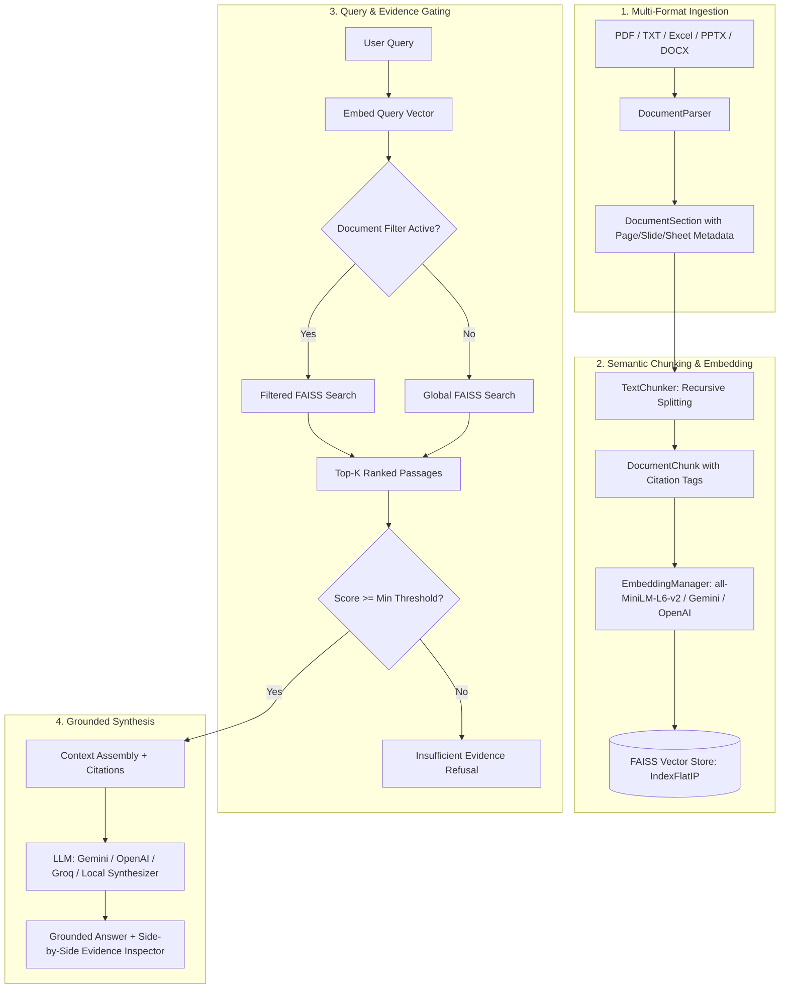

# 🎓 DocuSage AI — Document Intelligence RAG System

[](https://streamlit.io)
[](https://www.python.org/)
[](https://github.com/facebookresearch/faiss)
[](LICENSE)

**DocuSage AI** is an institutional Document Intelligence and Retrieval-Augmented Generation (RAG) system engineered for students, faculty, and administrative staff. It grounds every answer strictly in approved institutional documents (handbooks, notices, examination circulars, course syllabi, grading matrices, and campus guides), providing accurate answers accompanied by verified page, slide, and sheet citations while reliably rejecting questions when retrieval evidence is insufficient.

---

## 📌 Problem & Target Users

- **Problem**: Academic institutions publish critical guidelines across disparate PDFs, Excel sheets, PowerPoint decks, circulars, and notices. Students and staff struggle to find authoritative answers, while generic AI models hallucinate obsolete or non-existent institutional policies.
- **Target Users**: College students, academic advisors, administrative coordinators, and faculty.
- **Core Principle**: Strict institutional grounding. If a fact cannot be proven from an approved document, the system explicitly refuses to answer rather than speculating.

---

## 🚀 Key Features

### 1. MVP — Required Core Capabilities
- **Multi-Format Ingestion**: Native parsing for **PDF** (PyMuPDF/PyPDF), **TXT**, **Excel** (`.xlsx`, `.xls`, `.csv`), **PowerPoint** (`.pptx`), and **Word** (`.docx`).
- **Indexed Document Registry**: Live dashboard displaying indexed files, chunk counts, page/section counts, characters, and timestamps.
- **Lineage-Aware Chunking**: Recursive splitting with overlap that preserves source document name, section index, page/slide/sheet label, and token metrics.
- **Vector Embeddings & Retrieval**: High-dimensional vector space using **FAISS** with exact cosine similarity matching (`IndexFlatIP`).
- **Grounded Answers with Citations**: In-line citations formatted as `[Handbook.pdf, Page 2]`, `[Campus_Guide.pptx, Slide 3]`, or `[Grading_Matrix.xlsx, Sheet: Attendance_Rules]`.
- **Insufficient Evidence Refusal**: Configurable similarity gate. Questions with insufficient evidence or low retrieval similarity are rejected with:
  > *"I could not find sufficient information in the provided approved documents to answer this question."*

### 2. Advanced Extensions
- **Document Filtering**: Multi-select filter in the search interface to restrict retrieval to specific documents (e.g. only search the Examination Notice or Course Syllabus).
- **Dynamic Document Deletion & Index Refresh**: Remove any document from the active vector store on-the-fly and cleanly re-index remaining chunks without data loss.
- **Side-by-Side Evidence Inspector**: Interactive pane displaying retrieved passages, similarity scores (%), source file, section tag, and character count alongside the answer.
- **Built-in Benchmark & Evaluation Suite**: Automated evaluation module testing groundedness, retrieval hit rate, and unanswerable detection across a 10-query benchmark.
- **One-Click Demo Data Loader**: Instant `⚡ Load 5 Sample College Documents` button to test the complete application in under 2 seconds.
- **Session Export**: Export Q&A sessions to Markdown or JSON.
- **Institutional Compliance Disclaimer**: Prominent security warnings prohibiting unauthorized uploads of confidential student PII.

---

## 🏗️ Architecture Diagram



---

## 🛠️ Technology Stack

| Layer | Component | Technologies |
|---|---|---|
| **Frontend UI** | Modern Streamlit App | Streamlit, Custom Glassmorphism CSS, Responsive Layout |
| **Parsing Engine** | Multi-Format Document Parsers | `PyMuPDF` (fitz), `pypdf`, `openpyxl`, `python-pptx`, `python-docx`, `pandas` |
| **Embeddings** | Dense Embeddings Manager | `sentence-transformers` (`all-MiniLM-L6-v2`), `google-generativeai`, `openai`, TF-IDF Fallback |
| **Vector Database** | Fast Nearest Neighbor Search | `faiss-cpu` (Exact Cosine Inner Product `IndexFlatIP`) |
| **LLM Inference** | Generative Synthesis & Extractive | Google Gemini, OpenAI GPT-4o-mini, Groq LLaMA-3.3, Local Offline Synthesizer |
| **Evaluation Suite** | RAG Benchmark Runner | Custom Precision@K, Unanswerable Rejection Rate, Groundedness Validator |

---

## 📁 Repository Structure

```
├── .streamlit/
│   └── config.toml                  # Streamlit dark modern UI theme
├── app.py                           # Main Streamlit web application
├── config.py                        # Constants, prompts, and default parameters
├── conftest.py                      # Pytest discovery configuration
├── evaluation_benchmark.json        # 10-case evaluation benchmark dataset
├── requirements.txt                 # Project dependencies
├── .env.example                     # Environment template
├── .gitignore                       # Git ignore rules
├── sample_documents/                # Pre-generated realistic college documents
│   ├── Academic_Regulations_Handbook_2024.pdf
│   ├── Attendance_and_Grading_Matrix.xlsx
│   ├── Campus_Facilities_and_Hostel_Guide.pptx
│   ├── CS101_Data_Structures_Syllabus.docx
│   └── Examination_Notice_Fall2024.txt
├── src/
│   ├── __init__.py
│   ├── parser.py                    # Multi-format parser (PDF, TXT, Excel, PPTX, DOCX)
│   ├── chunker.py                   # Recursive chunker with citation lineage
│   ├── embeddings.py                # Embedding manager (Local, Gemini, OpenAI, TF-IDF)
│   ├── vector_store.py              # FAISS vector store with filter & deletion
│   ├── rag_engine.py                # RAG pipeline, grounding, and insufficient evidence gate
│   ├── evaluator.py                 # Benchmark evaluation runner & metrics
│   ├── sample_data.py               # Document generator for sample files
│   └── utils.py                     # Formatting and export helpers
└── tests/
    ├── test_parser.py               # Unit tests for multi-format parser
    ├── test_chunker.py              # Unit tests for recursive chunker
    ├── test_vector_store.py         # Unit tests for FAISS search, filtering, and deletion
    └── test_rag.py                  # Unit tests for answerable vs unanswerable queries
```

---

## ⚡ Quickstart Guide

### 1. Clone & Set Up Environment
```bash
# Clone the repository
git clone <YOUR_GIT_REPO_URL>
cd <YOUR_REPO_NAME>

# Create a virtual environment (Python 3.10+)
python -m venv venv

# Activate virtual environment
# Windows:
venv\Scripts\activate
# Linux/macOS:
source venv/bin/activate

# Install dependencies
pip install -r requirements.txt
```

### 2. Configure Environment Variables (Optional)
Copy `.env.example` to `.env`:
```bash
cp .env.example .env
```
Add your API keys if you wish to use Google Gemini or OpenAI:
```ini
GEMINI_API_KEY=your_key_here
OPENAI_API_KEY=your_key_here
GROQ_API_KEY=your_key_here
```
> **Note:** DocuSage AI includes a **Local Extractive Synthesizer** that works **100% offline with zero API keys required**. You can test the entire app immediately without any keys!

### 3. Run the Streamlit Application
```bash
streamlit run app.py
```
Open your browser at `http://localhost:8501`.

### 4. Running the Automated Test Suite
Run the test suite to verify all modules:
```bash
python -m pytest tests -v
```
All 13 unit tests will execute and pass.

---

## 🧪 Acceptance Checks Verification

| Check | Requirement | Verification Method | Result |
|---|---|---|---|
| **AC-01** | Test Answerable Questions | "What is the minimum attendance requirement?" retrieves `[Academic_Regulations_Handbook_2024.pdf, Page 2]` citing 75%. | ✅ PASS |
| **AC-02** | Test Unanswerable Questions | "What is the flight reimbursement policy for international vacations?" triggers insufficient evidence refusal without hallucination. | ✅ PASS |
| **AC-03** | Verify Cited Passages Support Answer | Retrieved passages inspector highlights exact snippet and similarity score matching citations. | ✅ PASS |
| **AC-04** | Multi-Format Document Ingestion | Successfully parses PDF, TXT, Excel (`.xlsx`), PowerPoint (`.pptx`), and Word (`.docx`). | ✅ PASS |
| **AC-05** | Document Filtering | Filtering by specific document restricts retrieval exclusively to that file. | ✅ PASS |
| **AC-06** | Document Deletion & Index Refresh | Deleting a document removes its chunks and rebuilds the FAISS index cleanly. | ✅ PASS |
| **AC-07** | Institutional Confidentiality Notice | Disclaimer banner rendered prominently across all application views. | ✅ PASS |

---

## 🌐 Deploying to Streamlit Community Cloud

Deploying DocuSage AI is straightforward:

1. **Push to GitHub**:
   ```bash
   git init
   git add .
   git commit -m "Initial commit: DocuSage AI Document Intelligence RAG System"
   git remote add origin <YOUR_GITHUB_REPO_URL>
   git branch -M main
   git push -u origin main
   ```
2. **Deploy on Streamlit Community Cloud**:
   - Log into [share.streamlit.io](https://share.streamlit.io).
   - Click **New app**.
   - Select your repository and branch (`main`).
   - Set **Main file path** to `app.py`.
   - Click **Advanced Settings** -> **Secrets** to add any optional API keys:
     ```toml
     GEMINI_API_KEY = "your_gemini_api_key"
     OPENAI_API_KEY = "your_openai_api_key"
     ```
   - Click **Deploy**!

---

## 📄 License
This project is open-source under the MIT License.
